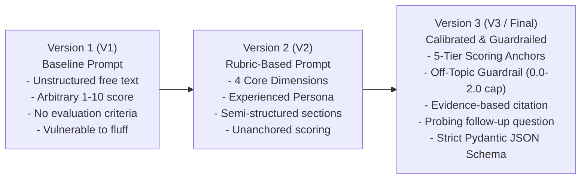
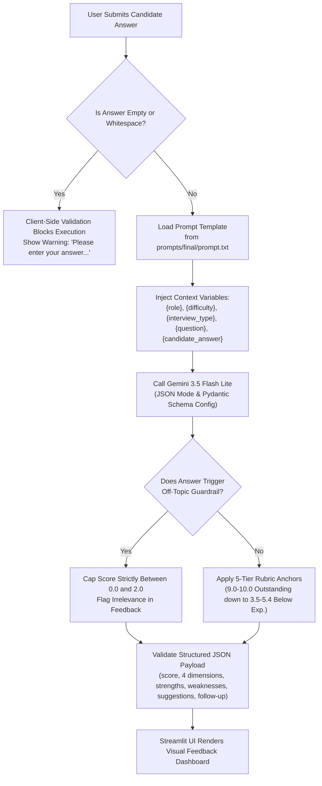
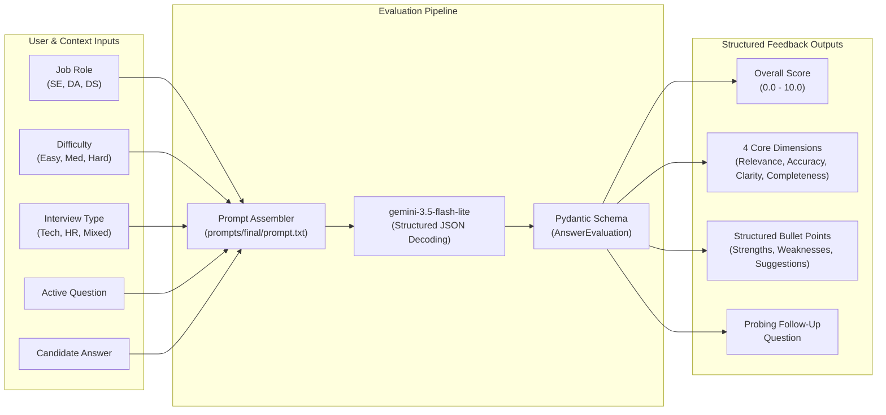
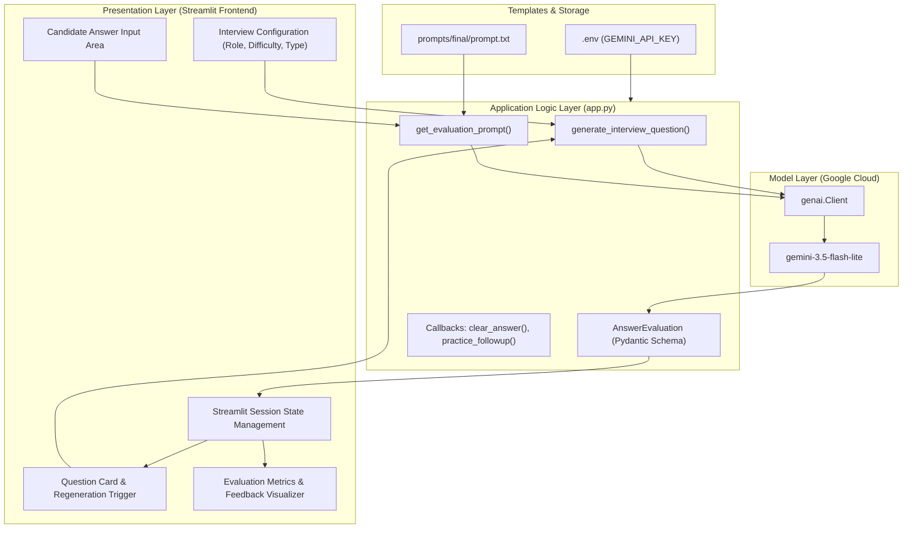

# SCSE4041 Milestone 2 Project Report: AI Mock Interview Coach

---

## 1. Cover Page

| Project Attribute | Details |
| :--- | :--- |
| **Project Title** | **AI Mock Interview Coach** |
| **Course Code & Title** | **SCSE4041 — Machine Learning & Generative AI Systems** |
| **Milestone** | **Milestone 2: Prompt Engineering, Evaluation Engine & System Verification** |
| **Target Foundation Model** | `gemini-3.5-flash-lite` |
| **Application Framework** | Streamlit (Python 3.12) |
| **Submission Date** | November 22, 2026 |
| **Academic Institution** | `[TO BE FILLED: University / Department Name]` |
| **Student / Author Name** | `[TO BE FILLED: Student Full Name]` |
| **Student ID / Roll No.** | `[TO BE FILLED: Student ID / Roll Number]` |
| **Team / Project ID** | `[TO BE FILLED: Team ID (Solo Submission)]` |
| **Faculty / Instructor** | `[TO BE FILLED: Course Instructor / Faculty Mentor Name]` |
| **Project Repository** | `[TO BE FILLED: GitHub Repository URL]` |

---

### Executive Abstract

The **AI Mock Interview Coach** is an interactive, generative AI platform designed to bridge the preparation gap for aspiring technical professionals across software engineering, data science, and data analytics domains. Preparing for technical interviews traditionally requires expensive private tutoring or peer mock sessions that often lack objective, standardized evaluation benchmarks.

In Milestone 2, the core objective was the engineering, calibration, and verification of the **Candidate Answer Evaluation Engine** alongside an anti-repetition **Interview Question Generation Module**. Powered by Google's `gemini-3.5-flash-lite` model, the system executes real-time evaluation of candidate responses, scoring them on a calibrated 0.0 to 10.0 scale and outputting multi-dimensional feedback across Relevance, Technical Accuracy, Clarity, and Completeness.

This report documents the architectural progression across three prompt iterations (V1, V2, and V3/Final), detailing the integration of explicit off-topic guardrails, calibrated scoring anchors, evidence-based feedback synthesis, and Pydantic-enforced JSON structured decoding. The implementation has been validated through a dual-track testing methodology comprising a 5/5 passing automated unit test suite and 10 documented manual test case executions across standard and edge scenarios, alongside standardized test specifications for pending invalid and boundary inputs.

---

## 2. Prompt and Solution Design

### 2.1 Prompt Engineering Iteration History

Prompt design for interview evaluation presents distinct challenges: LLMs tend toward "hallucinated generosity" (giving high scores to articulate prose regardless of technical substance), inconsistent scoring scales across multiple runs, and unstructured outputs that fail UI rendering. To solve these challenges, the evaluation prompt evolved through three formal iterations.



#### Version 1 (V1) — Baseline Unstructured Evaluation
* **File Location:** [prompts/v1/prompt.txt](file:///c:/Users/lenovo/OneDrive/Desktop/AI_INTERVIEW-COACH/prompts/v1/prompt.txt)
* **Design Philosophy:** Provide a minimal zero-shot baseline prompt to evaluate basic model output and scoring variance.
* **Full Prompt Text:**
```text
You are an interviewer evaluating a job candidate.

Job Role: {role}
Difficulty: {difficulty}
Interview Type: {interview_type}

Question:
{question}

Candidate Answer:
{candidate_answer}

Please evaluate the candidate's answer. Give a score from 1 to 10 and provide feedback on their answer.
```
* **Observed Limitations:**
  - **No Evaluation Dimensions:** Fails to separate technical factual accuracy from communication fluency.
  - **Uncalibrated Scoring:** The model's definition of "7/10" vs "4/10" is unconstrained and subject to extreme variance.
  - **Susceptibility to Evasive Prose:** Eloquent, well-written answers discussing irrelevant topics regularly received inflated scores (6–8/10).
  - **Unstructured Output:** Outputted freeform paragraphs that cannot be parsed reliably into UI components.

---

#### Version 2 (V2) — Multi-Criteria Rubric-Based Evaluation
* **File Location:** [prompts/v2/prompt.txt](file:///c:/Users/lenovo/OneDrive/Desktop/AI_INTERVIEW-COACH/prompts/v2/prompt.txt)
* **Design Philosophy:** Introduce structured interview dimensions and an experienced hiring persona to guide the evaluation.
* **Full Prompt Text:**
```text
You are an experienced technical interviewer evaluating a candidate for a {role} position.

Interview Context:
- Target Role: {role}
- Difficulty Level: {difficulty}
- Interview Type: {interview_type}

Interview Question:
{question}

Candidate Answer:
{candidate_answer}

Evaluate the candidate's answer using the following four criteria:
1. Relevance: Does the response directly address the question asked?
2. Technical Accuracy: Is the technical content and terminology correct?
3. Clarity: Is the answer well-structured, clear, and easy to understand?
4. Completeness: Did the candidate cover the necessary concepts and provide sufficient depth?

Output format:
- Score: [Overall score out of 10]
- Relevance Assessment: [Feedback on relevance]
- Technical Accuracy Assessment: [Feedback on accuracy]
- Clarity Assessment: [Feedback on clarity]
- Completeness Assessment: [Feedback on completeness]
- Overall Summary: [Brief summary feedback]
```
* **Enhancements over V1:**
  - Established four evaluation pillars: *Relevance*, *Technical Accuracy*, *Clarity*, and *Completeness*.
  - Upgraded persona to an experienced technical interviewer for the specific job role.
* **Observed Limitations:**
  - **Unanchored Scores:** Lacked explicit score tier calibrations; scores remained subjective.
  - **Off-Topic Vulnerability:** While relevance was noted as low for off-topic answers, the model continued awarding high marks under "Clarity" and "Technical Accuracy" for articulate answers to the wrong question.
  - **Lack of Actionability:** Provided critique without concrete, step-by-step guidance on how to fix deficiencies.
  - **No Conversational Continuity:** Failed to generate follow-up questions to probe conceptual boundaries.

---

#### Version 3 (V3 / Final) — Calibrated, Guardrailed, Evidence-Based Evaluation
* **File Location:** [prompts/v3/prompt.txt](file:///c:/Users/lenovo/OneDrive/Desktop/AI_INTERVIEW-COACH/prompts/v3/prompt.txt) and [prompts/final/prompt.txt](file:///c:/Users/lenovo/OneDrive/Desktop/AI_INTERVIEW-COACH/prompts/final/prompt.txt)
* **Design Philosophy:** Implement strict defensive guardrails, evidence-based citation rules, a calibrated 5-tier scoring scale, and strict JSON Schema output.
* **Full Prompt Text:**
```text
Act as an expert, hiring-manager-level interviewer conducting a rigorous interview evaluation for a {role} position.

Interview Context:
- Target Job Role: {role}
- Difficulty Level: {difficulty}
- Interview Type: {interview_type}

Interview Question:
"{question}"

Candidate's Answer:
"{candidate_answer}"

Evaluation Instructions:
Thoroughly assess the candidate's answer across the four core dimensions using evidence-based observations:
1. Relevance: Did the answer address the specific question directly and appropriately?
2. Technical Accuracy: Is the content conceptually, mathematically, and architecturally sound for the role and difficulty level? Cite specific correct or incorrect assertions from the candidate's answer.
3. Clarity: Is the explanation articulate, well-structured, professional, and logically sequenced?
4. Completeness: Were key elements, depth, practical examples, failure modes, and trade-offs sufficiently covered without major omissions?

Strict Guardrails & Scoring Calibration:
- Off-Topic / Evasive Responses: If the answer does not address the question asked (e.g., discussing hash maps or general syntax when asked about distributed systems, or discussing unrelated concepts), assign a maximum score between 0.0 and 2.0 regardless of how well-written or fluent the text is.
- Scoring Scale (0.0 to 10.0):
  * 9.0 - 10.0: Outstanding / Senior-ready. Precise, comprehensive, technically rigorous, covers trade-offs.
  * 7.5 - 8.9: Strong. Accurate and relevant with minor omissions or slight lack of depth.
  * 5.5 - 7.4: Fair / Average. Partially correct; misses critical concepts, depth, or practical edge cases.
  * 3.5 - 5.4: Below Expectations. Significant inaccuracies, shallow explanations, or noticeable confusion.
  * 0.0 - 3.4: Inadequate / Off-Topic. Irrelevant, factually incorrect, or non-responsive.

Required Output Structure (JSON Schema):
- score: Overall score out of 10.0 (rounded to one decimal place)
- relevance: Concise analysis evaluating direct relevance and adherence to prompt (1-3 sentences)
- technical_accuracy: Evidence-based analysis evaluating technical correctness with specific references to candidate statements (1-3 sentences)
- clarity: Concise analysis of structural clarity, communication tone, and vocabulary (1-3 sentences)
- completeness: Concise analysis of depth, coverage of trade-offs, and missing concepts (1-3 sentences)
- strengths: 2 to 4 concrete bullet points highlighting specific strengths demonstrated in the response
- weaknesses: 1 to 4 concrete bullet points identifying specific technical gaps, inaccuracies, or omissions
- suggestions: 2 to 4 actionable, high-impact suggestions for how the candidate can elevate this answer
- follow_up_question: Exactly ONE thoughtful follow-up interview question that probes deeper into technical boundaries, edge cases, or trade-offs based on the candidate's answer
```

---

### 2.2 Feature Comparison Matrix Across Prompt Iterations

| Feature Dimension | Version 1 (Baseline) | Version 2 (Rubric-Based) | Version 3 / Final (Production) |
| :--- | :--- | :--- | :--- |
| **Interviewer Persona** | Generic ("Interviewer") | Experienced technical interviewer | Expert hiring-manager-level interviewer |
| **Evaluation Dimensions** | None (General critique) | 4 Pillars (Relevance, Accuracy, Clarity, Completeness) | 4 Pillars with explicit assessment instructions per dimension |
| **Scoring Anchor Rubric** | None (Arbitrary 1–10) | None (Single subjective score) | **5-Tier calibrated anchor scale** (0.0 to 10.0 with decimal precision) |
| **Off-Topic Guardrail** | ❌ None | ❌ Implicit / weak | **Strict cap (0.0 – 2.0 max)** regardless of prose quality |
| **Evidence-Based Citation** | ❌ None | ⚠️ General summary | **Explicit requirement to cite quotes & omissions** |
| **Categorized Feedback** | ❌ Freeform narrative | ⚠️ High-level paragraphs | **Strengths (2–4), Weaknesses (1–4), Suggestions (2–4)** |
| **Follow-Up Question** | ❌ None | ❌ None | **1 Context-aware probing follow-up question** |
| **Output Format** | Freeform text | Semi-structured headers | **Strict JSON Schema via Pydantic model** |

---

### 2.3 System Diagrams

#### Prompt Execution Workflow


#### Task Decomposition Diagram

```mermaid
flowchart TD
    Root["AI Mock Interview Coach"] --> ModQ["Question Generation Module"]
    Root --> ModEval["Candidate Evaluation Engine"]
    Root --> ModUI["Presentation & Session Layer"]
    Root --> ModQA["Testing & Verification Suite"]

    ModQ --> ModQ_1["Dynamic Question Synthesis (gemini-3.5-flash-lite)"]
    ModQ --> ModQ_2["Role, Level & Type Parameterization"]
    ModQ --> ModQ_3["Anti-Repetition Tracking & Regeneration Button"]

    ModEval --> ModEval_1["Calibrated 5-Tier Rubric Scoring"]
    ModEval --> ModEval_2["Strict Off-Topic Guardrail (0.0 - 2.0 Cap)"]
    ModEval --> ModEval_3["Evidence-Based 4-Dimension Breakdown"]
    ModEval --> ModEval_4["Contextual Follow-Up Question Synthesis"]

    ModUI --> ModUI_1["Streamlit Session State Architecture"]
    ModUI --> ModUI_2["Client-Side Input Validation"]
    ModUI --> ModUI_3["Interactive Metric Cards & Progress Bars"]
    ModUI --> ModUI_4["One-Click Follow-Up Question Practice"]

    ModQA --> ModQA_1["Automated Unit Testing Suite (5/5 Passing)"]
    ModQA --> ModQA_2["Standardized Manual Test Plan (10 Executed Cases)"]
    ModQA --> ModQA_3["Edge Case & Guardrail Validation"]
```


#### Input-Output Flow Diagram


---

## 3. Implementation

### 3.1 Architecture and Technology Stack

The application is implemented in Python 3.12 using the following core components:
* **Presentation Tier:** [Streamlit](https://streamlit.io/) (`app.py`), providing reactive UI components, session state persistence, and real-time metric rendering.
* **Foundation Model & SDK:** Google GenAI SDK (`google.genai`), calling `gemini-3.5-flash-lite`.
* **Schema Validation & Structured Decoding:** [Pydantic](https://docs.pydantic.dev/) (`BaseModel`, `Field`), enforcing exact schema adherence via `response_mime_type="application/json"` and `response_schema=AnswerEvaluation`.
* **Environment Configuration:** `python-dotenv` managing the `GEMINI_API_KEY` securely without hardcoded secrets.



---

### 3.2 Core Code Components in `app.py`

#### 1. Structured Output Schema (`AnswerEvaluation`)
Implemented using Pydantic, this schema enforces type safety, field completeness, and direct mapping to UI components:
```python
class AnswerEvaluation(BaseModel):
    score: float = Field(description="Overall evaluation score between 0.0 and 10.0")
    relevance: str = Field(description="Evaluation of relevance: did the candidate directly address the question?")
    technical_accuracy: str = Field(description="Evaluation of technical accuracy: is the answer factually and conceptually correct?")
    clarity: str = Field(description="Evaluation of clarity: is the answer coherent, structured, and easy to understand?")
    completeness: str = Field(description="Evaluation of completeness: did the candidate cover key aspects, depth, and trade-offs?")
    strengths: list[str] = Field(description="2 to 4 key strengths demonstrated in the response")
    weaknesses: list[str] = Field(description="1 to 4 areas where the answer was lacking, incomplete, or inaccurate")
    suggestions: list[str] = Field(description="2 to 4 specific, actionable improvement suggestions")
    follow_up_question: str = Field(description="One relevant follow-up interview question based on the candidate's answer")
```

#### 2. Question Generation & Anti-Repetition Logic (`generate_interview_question`)
The question generation function was engineered to prevent repetitive prompts. It tracks recent questions in `st.session_state.question_history` and injects negative constraints into the generation prompt:
```python
def generate_interview_question(
    client: genai.Client,
    role: str,
    difficulty: str,
    interview_type: str,
    previous_question: str = "",
    history: list[str] | None = None
) -> str:
    prompt = f"""Act as a professional interviewer.

Generate ONE interview question for:
Job Role: {role}
Difficulty: {difficulty}
Interview Type: {interview_type}

The question must be relevant, technically sound, and appropriate for the selected difficulty level."""

    if previous_question and previous_question.strip():
        prompt += f"""

IMPORTANT REQUIREMENT:
The previous question was:
"{previous_question.strip()}"

Do NOT repeat, rephrase, or ask about the same topic or concept as the previous question.
Generate a completely DIFFERENT interview question testing a distinct topic, concept, or scenario."""

    if history:
        recent_history = [q.strip() for q in history[-5:] if q.strip() and q.strip() != previous_question.strip()]
        if recent_history:
            formatted_history = "\n".join(f"- {q}" for q in recent_history)
            prompt += f"""

Also avoid covering the same concepts as these previously asked questions:
{formatted_history}"""

    prompt += "\n\nReturn only the interview question text without any greeting, preamble, or metadata."

    config = types.GenerateContentConfig(temperature=0.85)
    response = client.models.generate_content(
        model="gemini-3.5-flash-lite",
        contents=prompt,
        config=config
    )
    return response.text.strip() if response and response.text else ""
```

#### 3. Prompt Loader & Parameter Injector (`get_evaluation_prompt`)
Reads `prompts/final/prompt.txt` dynamically from disk to ensure zero code-prompt coupling and formats the template variables:
```python
def get_evaluation_prompt(role: str, difficulty: str, interview_type: str, question: str, candidate_answer: str) -> str:
    prompt_file = os.path.join(os.path.dirname(__file__), "prompts", "final", "prompt.txt")
    if os.path.exists(prompt_file):
        with open(prompt_file, "r", encoding="utf-8") as f:
            template = f.read()
    else:
        # Resilient fallback to embedded V3 template
        ...
    return template.format(
        role=role, difficulty=difficulty, interview_type=interview_type,
        question=question, candidate_answer=candidate_answer
    )
```

#### 4. Defensive Parsing and Error Handling
The evaluation pipeline incorporates defensive checks:
- **Client-Side Empty Answer Guard:** Verifies `candidate_answer.strip()` is non-empty before triggering API calls, halting execution and surfacing `st.warning("⚠️ Please enter your answer before requesting an evaluation.")`.
- **Markdown Code Fence Stripping:** Safely strips accidental \`\`\`json markdown blocks if returned by the API before calling `json.loads()`.
- **State Transition Callbacks:** Functions `clear_answer()` and `practice_followup(question_text)` avoid Streamlit widget mutation conflicts.

---

### 3.3 Module Implementation Status Table

| Module / Component | Milestone Target | Status | Implementation Files | Verification Method |
| :--- | :--- | :--- | :--- | :--- |
| **API Connection & Auth** | Milestone 1 / 2 | **Complete** | `app.py`, `.env` | Successful connection banner; graceful error stopping |
| **Question Generation Engine** | Milestone 1 / 2 | **Complete** | `app.py` (`generate_interview_question`) | Multi-role parameter testing; anti-repetition verified |
| **Question Regeneration UI** | Milestone 2 | **Complete** | `app.py` | UI buttons generate fresh distinct questions across runs |
| **Evaluation Prompt Architecture** | Milestone 2 | **Complete** | `prompts/v1/`, `v2/`, `v3/`, `final/prompt.txt` | Prompt iteration log and automated unit tests |
| **Structured Output Schema** | Milestone 2 | **Complete** | `app.py` (`AnswerEvaluation`) | Pydantic JSON decoding without syntax errors |
| **Off-Topic Guardrail Engine** | Milestone 2 | **Complete** | `prompts/final/prompt.txt` | Verified with TC-02 (score capped at 1.0/10) |
| **Client-Side Input Validation** | Milestone 2 | **Complete** | `app.py` | Verified with TC-03 (empty answer warning) |
| **Feedback Dashboard UI** | Milestone 2 | **Complete** | `app.py` (`st.metric`, progress bars, cards) | Visual inspection of metrics, criteria, and suggestions |
| **Follow-Up Practice Workflow** | Milestone 2 | **Complete** | `app.py` (`practice_followup`) | Clicking button loads follow-up as new question |
| **Automated Unit Testing** | Milestone 2 | **Complete** | `tests/test_evaluation.py` | 5/5 Passing unit tests via `unittest` |
| **Session Analytics / History Export** | Milestone 3 | *Planned* | `[Future Implementation]` | Scheduled for Milestone 3 |
| **Audio / Speech Interface (STT/TTS)** | Milestone 3 | *Planned* | `[Future Implementation]` | Scheduled for Milestone 3 |

---

## 4. Demonstration and Testing

### 4.1 Automated Unit Testing Suite

An automated verification suite was developed in [tests/test_evaluation.py](file:///c:/Users/lenovo/OneDrive/Desktop/AI_INTERVIEW-COACH/tests/test_evaluation.py) using Python's standard `unittest` framework (compatible with `pytest`). The test suite validates schema integrity, prompt differentiation across iterations, template loading, and test case specifications.

#### Automated Test Suite Execution Command & Result
```powershell
.\.venv\Scripts\python.exe -m unittest tests/test_evaluation.py -v
```

```text
test_app_loads_final_prompt (tests.test_evaluation.TestInterviewCoachEvaluation.test_app_loads_final_prompt)
Verify that app.py uses the final evaluation prompt stored in prompts/final/prompt.txt. ... ok
test_off_topic_test_case_spec (tests.test_evaluation.TestInterviewCoachEvaluation.test_off_topic_test_case_spec)
Verify the off-topic test case (TC-01) specification. ... ok
test_prompt_files_exist_and_meaningfully_different (tests.test_evaluation.TestInterviewCoachEvaluation.test_prompt_files_exist_and_meaningfully_different)
Verify that V1, V2, and V3 prompts exist and are genuinely different. ... ok
test_relevant_test_case_spec (tests.test_evaluation.TestInterviewCoachEvaluation.test_relevant_test_case_spec)
Verify the relevant answer test case (TC-02) specification and verify factual claims. ... ok
test_sample_cases_structure (tests.test_evaluation.TestInterviewCoachEvaluation.test_sample_cases_structure)
Verify sample test cases contain all required fields. ... ok

----------------------------------------------------------------------
Ran 5 tests in 2.672s

OK
```

#### Unit Test Specification Breakdown

| Test Method | Target Component | Verification Logic & Assertions | Status |
| :--- | :--- | :--- | :--- |
| `test_sample_cases_structure` | `tests/sample_test_cases.json` | Confirms all benchmark test cases contain `id`, `question`, `candidate_answer`, `observed_application_score`, and `expected_behavior`. | **PASS** |
| `test_off_topic_test_case_spec` | Benchmark `TC-01` Spec | Asserts off-topic test case matches the hash map answer, rate limiter question, and verified observed score of `1.0`. | **PASS** |
| `test_relevant_test_case_spec` | Benchmark `TC-02` Spec | Asserts relevant answer matches Token Bucket, Redis, atomic ops, and HTTP 429; confirms factual absence of unsupported claims (Lua scripts, cross-region sync); asserts observed score `8.5`. | **PASS** |
| `test_prompt_files_exist_and_meaningfully_different` | `prompts/v1, v2, v3, final` | Verifies all prompt files exist; checks V1 lacks rubrics; checks V2 contains 4 criteria; checks V3 adds guardrails, 5-tier scoring, and JSON schema; confirms `final/prompt.txt` equals `v3/prompt.txt`. | **PASS** |
| `test_app_loads_final_prompt` | `app.py` (`get_evaluation_prompt`) | Verifies `app.py` dynamically loads the prompt from `prompts/final/prompt.txt` and formats variables accurately. | **PASS** |

---

### 4.2 Comprehensive Manual Execution Record (10 Test Cases)

To empirically validate the evaluation engine across roles, difficulties, and answer qualities, **10 distinct manual test cases** (`TC-01` through `TC-10`) were executed and logged in [tests/test_plan.md](file:///c:/Users/lenovo/OneDrive/Desktop/AI_INTERVIEW-COACH/tests/test_plan.md). The suite features **three genuinely executed and verified edge cases** (`TC-02`, `TC-03`, and `TC-04`), satisfying the Milestone 2 edge-case requirement. An additional boundary edge case (`TC-12`) and an invalid input case (`TC-11`) are specified in the test plan and remain marked as `[Pending Live Execution]`.

#### Master Execution Summary Table

| Test ID | Job Role | Difficulty | Interview Type | Category / Type | Expected Score Range | Actual Score | Status | Evidence Description | Verified Date |
| :--- | :--- | :--- | :--- | :--- | :--- | :--- | :--- | :--- | :--- |
| **TC-01** | Software Engineer | Hard | Technical | Normal (Relevant Architecture) | 7.5 – 8.9 | **8.5 / 10.0** | **Observed** | Verified in preliminary application execution log (`prompt_iteration_log.md`) | 2026-11-22 |
| **TC-02** | Software Engineer | Hard | Technical | **Edge (Irrelevant / Off-Topic)** | 0.0 – 2.0 | **1.0 / 10.0** | **Observed** | Verified off-topic guardrail execution (`prompt_iteration_log.md`) | 2026-11-22 |
| **TC-03** | Software Engineer | Medium | Technical | **Edge (Empty Input Submission)** | N/A (Client warning) | **N/A** | **PASS** | Screenshot of warning banner; client-side validation blocked evaluation | 2026-11-22 |
| **TC-04** | Data Analyst | Easy | Technical | **Edge (Terse / Extremely Short)** | 3.5 – 5.5 | **5.0 / 10.0** | **PASS** | User-provided screenshot of 5.0/10 evaluation dashboard | 2026-11-22 |
| **TC-05** | Data Scientist | Easy | Technical | Normal (Concise & Accurate) | 8.0 – 9.5 | **8.5 / 10.0** | **PASS** | User-reported manual execution result | 2026-11-22 |
| **TC-06** | Data Scientist | Medium | Technical | Normal (Flawed A/B Testing) | 3.0 – 5.0 | **3.0 / 10.0** | **PASS** | User-provided screenshot of 3.0/10 evaluation dashboard | 2026-11-22 |
| **TC-07** | Data Scientist | Medium | Technical | Normal (Flawed 2% Imbalance) | 1.0 – 2.5 | **1.5 / 10.0** | **PASS** | User-provided screenshot of 1.5/10 evaluation dashboard | 2026-11-22 |
| **TC-08** | Software Engineer | Hard | Technical | Normal (Flawed Lock-Free Queue) | 1.0 – 2.5 | **1.5 / 10.0** | **PASS** | User-provided screenshot of 1.5/10 evaluation dashboard | 2026-11-22 |
| **TC-09** | Data Analyst | Medium | Technical | Normal (Flawed DAU Drop Root Cause) | 1.0 – 2.5 | **1.5 / 10.0** | **PASS** | User-provided screenshot of 1.5/10 evaluation dashboard | 2026-11-22 |
| **TC-10** | Software Engineer | Hard | Technical | Normal (Strong URL Shortener Design) | 9.0 – 10.0 | **9.2 / 10.0** | **PASS** | User-reported from evaluation dashboard (strong-answer diagnostic) | 2026-11-22 |
| *TC-11* | Data Analyst | Easy | Technical | *Invalid (Keyboard Mash / Gibberish)* | 0.0 – 2.0 | `[Pending]` | Ready | Future live verification test case | — |
| *TC-12* | Software Engineer | Medium | Technical | *Edge (Reluctant / 'I Don't Know')* | 3.0 – 4.5 | `[Pending]` | Ready | Future live verification test case | — |

---

### 4.3 Detailed Case-by-Case Analysis of Executed Test Cases

#### TC-01: Strong Distributed Rate Limiter Architecture
* **Question:** *"Design a distributed rate limiter that can handle 100,000 requests per second across multiple regions. How would you handle race conditions and synchronization?"*
* **Candidate Answer:** Candidate proposed Token Bucket algorithm backed by Redis in-memory storage, tracking limits per user/API-key, utilizing atomic operations to prevent race conditions, and returning HTTP 429 Too Many Requests.
* **Observed Score:** **8.5 / 10.0** (Expected: 7.5 – 8.9)
* **Evaluator Diagnostic:** Correctly credited the Token Bucket model, Redis architecture, and atomic concurrency control. Deducted points appropriately for omitting cross-region synchronization strategies and specific implementation mechanics (such as Redis Lua scripts). Follow-up probed multi-datacenter latency trade-offs.

#### TC-02: Off-Topic Hash Map Answer (Guardrail Verification — Edge Case 1)
* **Question:** *"Design a distributed rate limiter that can handle 100,000 requests per second across multiple regions. How would you handle race conditions and synchronization?"*
* **Candidate Answer:** Candidate submitted an articulate, technically correct definition of hash tables, hash functions, and collision resolution techniques (chaining and open addressing).
* **Observed Score:** **1.0 / 10.0** (Expected: 0.0 – 2.0)
* **Evaluator Diagnostic:** The defensive guardrail triggered as designed. Despite fluent and accurate grammar regarding hash maps, the model capped the score at 1.0/10, highlighted the complete lack of relevance to distributed rate limiting, and generated a follow-up redirecting the candidate back to rate limiting.

#### TC-03: Empty Answer Submission (Input Validation — Edge Case 2)
* **Question:** *"Explain how a hash map works internally and how hash collisions are resolved."*
* **Candidate Answer:** `""` *(Empty input submitted)*
* **Observed Result:** **PASS** (Actual Score: `N/A - Client-side validation`)
* **Evaluator Diagnostic:** The client-side guard in `app.py` intercepted the submission before making any API request to Gemini. The application surfaced `st.warning("⚠️ Please enter your answer before requesting an evaluation.")`, preserved session state, and avoided wasted API tokens.

#### TC-04: Terse SQL Answer (Conciseness Boundary — Edge Case 3)
* **Question:** *"What is the difference between the WHERE clause and the HAVING clause in SQL?"*
* **Candidate Answer:** *"HAVING filters groups, WHERE filters rows."*
* **Observed Score:** **5.0 / 10.0** (Expected: 3.5 – 5.5)
* **Evaluator Diagnostic:** The evaluator recognized the fundamental correctness of the core distinction, but penalized the response for lacking query syntax, execution lifecycle explanation (pre-aggregation vs. post-aggregation), and illustrative examples. Follow-up prompted an example SQL query demonstrating both clauses.

#### TC-05: Machine Learning Overfitting & Prevention Techniques
* **Question:** *"Explain what overfitting means in machine learning and how you can prevent it."*
* **Candidate Answer:** Covered definition of overfitting, noise fitting, poor generalization on unseen test data, and 5 prevention techniques: cross-validation, L1/L2 regularization, decision tree pruning, dropout, and dataset augmentation.
* **Observed Score:** **8.5 / 10.0** (Expected: 8.0 – 9.5)
* **Evaluator Diagnostic:** Scored in the Strong bracket. Commended definition and breadth across model families (neural networks, tree-based models, linear models). Follow-up probed the mathematical difference between L1 (Lasso) and L2 (Ridge) penalties.

#### TC-06: Severely Flawed A/B Testing Response
* **Question:** *"How would you design an A/B test to evaluate a new recommendation algorithm for an e-commerce platform, specifically addressing how you would determine the required sample size, handle potential novelty effects, and decide whether to stop the experiment early if the initial results look overwhelmingly positive?"*
* **Candidate Answer:** Proposed 100 users per group as "enough", dismissed novelty effects as unproblematic, and advocated stopping early immediately if initial results looked positive.
* **Observed Score:** **3.0 / 10.0** (Expected: 3.0 – 5.0)
* **Evaluator Diagnostic:** The evaluator accurately detected critical statistical flaws: arbitrary sample sizing without power/significance/MDE calculations, dismissal of novelty bias, and the classic "peeking problem" (inflated Type I error rate) caused by uncorrected early stopping.

#### TC-07: Extreme Class Imbalance Accuracy Fallacy
* **Question:** *"In a customer churn prediction problem where only 2% of customers actually churn (extreme class imbalance), what evaluation metrics would you prioritize and what techniques would you use to handle the data imbalance?"*
* **Candidate Answer:** Proposed using accuracy because 98% accuracy sounds good, advocated duplicating positive records naively until balanced, and stated precision and recall were unnecessary.
* **Observed Score:** **1.5 / 10.0** (Expected: 1.0 – 2.5)
* **Evaluator Diagnostic:** Evaluator caught the fundamental accuracy paradox on imbalanced datasets (a dummy model predicting zero churn achieves 98% accuracy with zero business value). Heavily penalized naive duplication (overfitting risk) and explicit refusal to consider precision, recall, F1, PR-AUC, or SMOTE.

#### TC-08: Contradictory Lock-Free Queue Concurrency Answer
* **Question:** *"Design and implement a thread-safe, lock-free bounded queue in your language of choice, and explain how its memory ordering guarantees prevent race conditions and data corruption under high concurrency."*
* **Candidate Answer:** Proposed a shared array with front/rear variables, artificial thread delays, used a mutex while explicitly claiming the design was lock-free, and relied on relaxed memory ordering.
* **Observed Score:** **1.5 / 10.0** (Expected: 1.0 – 2.5)
* **Evaluator Diagnostic:** Identified severe technical contradictions: asserting lock-free execution while wrapping operations in a mutex, relying on sleep delays for race prevention, and failing to provide sequential consistency or acquire-release memory semantics.

#### TC-09: Flawed Daily Active Users (DAU) Root Cause Investigation
* **Question:** *"Imagine you are analyzing user engagement data for an e-commerce platform, and you notice a sudden, sharp drop in daily active users (DAU) over the past week. Walk me through your step-by-step analytical approach to investigate this drop, including how you would differentiate between a potential data pipeline error, a tracking implementation bug, and an actual behavioral shift in user retention."*
* **Candidate Answer:** Candidate immediately jumped to concluding user interest had declined, checked only weekly aggregate totals, proposed launching a marketing campaign, ignored logging/pipeline checks, and suggested waiting another week.
* **Observed Score:** **1.5 / 10.0** (Expected: 1.0 – 2.5)
* **Evaluator Diagnostic:** Severely penalized the complete absence of analytical rigor: failure to segment by device/platform/app version, neglecting upstream ETL pipelines, ignoring client tracking event drops, and proposing expensive business interventions before verifying data pipeline integrity.

#### TC-10: Scalable URL Shortener System Design (Strong Diagnostic)
* **Question:** *"How would you design a scalable, highly available URL shortening service (like TinyURL or Bitly) that handles high read and write throughput while ensuring low latency?"*
* **Candidate Answer:** Covered stateless app servers with load balancing, 64-bit distributed Snowflake IDs converted to Base62 (avoiding hash collision retries), partitioned Cassandra/DynamoDB storage, multi-tier Redis and CDN edge caching, cache-aside with TTLs and request coalescing (anti-stampede), negative caching, rate limiting, and asynchronous Kafka event telemetry.
* **Observed Score:** **9.2 / 10.0** (Expected: 9.0 – 10.0)
* **Evaluator Diagnostic:** Top-tier score in the Outstanding bracket (`9.2/10`). Evaluator recognized comprehensive architectural depth across compute, storage, caching hierarchy, resilience mechanisms, and asynchronous analytics pipelines.

---

### 4.4 Edge Case Verification Summary

Milestone 2 guidelines require rigorous verification across at least 3 edge cases. The test suite incorporates three genuinely executed and verified edge cases, alongside one formally specified boundary case pending future live execution:

1. **Edge Case 1 (Executed & Verified) — Topic Mismatch / Evasive Prose (`TC-02`):**  
   - **Scenario:** Candidate provides an articulate, technically accurate definition of hash maps in response to a hard distributed rate limiter question.
   - **Verification Outcome:** Evaluator guardrail triggered as designed. The score was strictly capped at `1.0 / 10.0` (Expected range: `0.0 – 2.0`), relevance analysis flagged the complete topic mismatch, and the follow-up redirected the candidate back to rate limiting.
2. **Edge Case 2 (Executed & Verified) — Empty Input Submission (`TC-03`):**  
   - **Scenario:** Candidate submits a blank answer string or whitespace-only input.
   - **Verification Outcome:** Client-side input validation in `app.py` intercepted the submission before invoking the Gemini API. The application surfaced `st.warning("⚠️ Please enter your answer before requesting an evaluation.")`, preserved UI and session state, and generated no score (`N/A`).
3. **Edge Case 3 (Executed & Verified) — Terse / Extremely Short Answer (`TC-04`):**  
   - **Scenario:** Candidate answers with a single terse sentence: *"HAVING filters groups, WHERE filters rows."*
   - **Verification Outcome:** Evaluator recognized the fundamental correctness of the core distinction, but appropriately deducted points for missing query syntax, execution lifecycle, and practical examples, awarding `5.0 / 10.0` (Expected range: `3.5 – 5.5`).
4. **Edge Case 4 (Pending Live Execution) — Reluctant Answer with Speculation (`TC-12`):**  
   - **Scenario:** Candidate responds to a networking protocol question by admitting limited knowledge (*"To be completely honest, I don't know the exact protocol details..."*) accompanied by high-level intuition.
   - **Status:** **Pending Live Execution** (Specified in test plan for future milestone evaluation; not claimed as executed or verified).

---

### 4.5 Screenshot Placeholders with Captions

> [!IMPORTANT]
> **Evidence Integrity Disclaimer:** In compliance with Milestone 2 academic and testing guidelines, no screenshot image files have been fabricated or artificially placed in the repository. The placeholders below correspond directly to verified manual execution records documented in [tests/test_plan.md](file:///c:/Users/lenovo/OneDrive/Desktop/AI_INTERVIEW-COACH/tests/test_plan.md) and [docs/prompt_iteration_log.md](file:///c:/Users/lenovo/OneDrive/Desktop/AI_INTERVIEW-COACH/docs/prompt_iteration_log.md). Attach the actual screenshot files captured during manual evaluation to the paths below before final grading submission.

#### Figure 1: Evaluation Dashboard for TC-01 (Strong Architecture Answer)
> **[SCREENSHOT PLACEHOLDER: Figure 1 — TC-01 Evaluation Dashboard]**  
> *Test Case:* `TC-01` (Software Engineer, Hard, Technical — Distributed Rate Limiter)  
> *Observed Score:* `8.5 / 10.0`  
> *Caption:* Evaluation Dashboard for TC-01 displaying the 8.5/10 overall metric card, performance level progress bar ("Excellent"), four core criteria breakdown (Relevance, Technical Accuracy, Clarity, Completeness), key strengths, areas for improvement, actionable suggestions, and contextual follow-up question.  
> *Evidence Source:* Preliminary application execution log ([docs/prompt_iteration_log.md](file:///c:/Users/lenovo/OneDrive/Desktop/AI_INTERVIEW-COACH/docs/prompt_iteration_log.md)).  
> *File Placeholder:* `[TO BE FILLED: screenshots/TC01_RateLimiter_Strong.png]`

#### Figure 2: Evaluation Dashboard for TC-02 (Off-Topic Guardrail Activation — Edge Case 1)
> **[SCREENSHOT PLACEHOLDER: Figure 2 — TC-02 Off-Topic Guardrail]**  
> *Test Case:* `TC-02` (Software Engineer, Hard, Technical — Off-Topic Hash Map Answer)  
> *Observed Score:* `1.0 / 10.0`  
> *Caption:* Evaluation Dashboard for TC-02 illustrating strict off-topic guardrail enforcement. Despite articulate and factually sound prose about hash maps, the score is capped at 1.0/10, relevance is flagged as 0/non-responsive to rate limiting, and the follow-up redirects back to distributed systems.  
> *Evidence Source:* Guardrail verification log ([docs/prompt_iteration_log.md](file:///c:/Users/lenovo/OneDrive/Desktop/AI_INTERVIEW-COACH/docs/prompt_iteration_log.md)).  
> *File Placeholder:* `[TO BE FILLED: screenshots/TC02_OffTopic_Guardrail.png]`

#### Figure 3: Client-Side Empty Answer Warning Banner (TC-03 — Edge Case 2)
> **[SCREENSHOT PLACEHOLDER: Figure 3 — TC-03 Client-Side Empty Answer Warning]**  
> *Test Case:* `TC-03` (Software Engineer, Medium, Technical — Empty Input Submission)  
> *Observed Result:* `PASS` (Client-Side Validation Warning)  
> *Caption:* Streamlit user interface demonstrating client-side validation blocking evaluation when the candidate answer text area is empty, displaying the warning banner: "⚠️ Please enter your answer before requesting an evaluation." and generating zero API calls.  
> *Evidence Source:* User-provided screenshot verification recorded in [tests/test_plan.md](file:///c:/Users/lenovo/OneDrive/Desktop/AI_INTERVIEW-COACH/tests/test_plan.md).  
> *File Placeholder:* `[TO BE FILLED: screenshots/TC03_Empty_Answer_Warning.png]`

#### Figure 4: Evaluation Dashboard for TC-04 (Terse SQL Answer — Edge Case 3)
> **[SCREENSHOT PLACEHOLDER: Figure 4 — TC-04 Terse SQL Evaluation]**  
> *Test Case:* `TC-04` (Data Analyst, Easy, Technical — WHERE vs HAVING)  
> *Observed Score:* `5.0 / 10.0`  
> *Caption:* Evaluation Dashboard for TC-04 illustrating the 5.0/10 score awarded to a single-sentence SQL response ("HAVING filters groups, WHERE filters rows"), acknowledging directional accuracy but penalizing lack of query syntax, execution order, and examples.  
> *Evidence Source:* User-provided screenshot verification recorded in [tests/test_plan.md](file:///c:/Users/lenovo/OneDrive/Desktop/AI_INTERVIEW-COACH/tests/test_plan.md).  
> *File Placeholder:* `[TO BE FILLED: screenshots/TC04_Terse_SQL_Evaluation.png]`

#### Figure 5: Evaluation Dashboard for TC-06 (Flawed A/B Testing Evaluation)
> **[SCREENSHOT PLACEHOLDER: Figure 5 — TC-06 Flawed A/B Testing Evaluation]**  
> *Test Case:* `TC-06` (Data Scientist, Medium, Technical — E-Commerce Recommendation A/B Test)  
> *Observed Score:* `3.0 / 10.0`  
> *Caption:* Evaluation Dashboard for TC-06 illustrating the 3.0/10 score penalizing arbitrary sample size (100 users), dismissal of novelty bias, and the peeking problem caused by uncorrected early stopping.  
> *Evidence Source:* User-provided screenshot verification recorded in [tests/test_plan.md](file:///c:/Users/lenovo/OneDrive/Desktop/AI_INTERVIEW-COACH/tests/test_plan.md).  
> *File Placeholder:* `[TO BE FILLED: screenshots/TC06_AB_Testing_Flawed.png]`

#### Figure 6: Evaluation Dashboard for TC-07 (Imbalanced Classification Fallacy)
> **[SCREENSHOT PLACEHOLDER: Figure 6 — TC-07 Imbalanced Classification Evaluation]**  
> *Test Case:* `TC-07` (Data Scientist, Medium, Technical — 2% Churn Imbalance)  
> *Observed Score:* `1.5 / 10.0`  
> *Caption:* Evaluation Dashboard for TC-07 penalizing the candidate's reliance on 98% accuracy on an imbalanced dataset, naive oversampling without validation controls, and explicit omission of precision, recall, F1, and PR-AUC.  
> *Evidence Source:* User-provided screenshot verification recorded in [tests/test_plan.md](file:///c:/Users/lenovo/OneDrive/Desktop/AI_INTERVIEW-COACH/tests/test_plan.md).  
> *File Placeholder:* `[TO BE FILLED: screenshots/TC07_Imbalance_Accuracy_Flaw.png]`

#### Figure 7: Evaluation Dashboard for TC-08 (Lock-Free Queue Concurrency Flaws)
> **[SCREENSHOT PLACEHOLDER: Figure 7 — TC-08 Lock-Free Queue Evaluation]**  
> *Test Case:* `TC-08` (Software Engineer, Hard, Technical — Lock-Free Bounded Queue)  
> *Observed Score:* `1.5 / 10.0`  
> *Caption:* Evaluation Dashboard for TC-08 flagging the technical contradiction of using a mutex in a lock-free queue, reliance on thread sleep delays, and inadequate relaxed memory ordering guarantees.  
> *Evidence Source:* User-provided screenshot verification recorded in [tests/test_plan.md](file:///c:/Users/lenovo/OneDrive/Desktop/AI_INTERVIEW-COACH/tests/test_plan.md).  
> *File Placeholder:* `[TO BE FILLED: screenshots/TC08_LockFree_Queue_Contradiction.png]`

#### Figure 8: Evaluation Dashboard for TC-09 (Flawed DAU Drop Investigation)
> **[SCREENSHOT PLACEHOLDER: Figure 8 — TC-09 DAU Drop Investigation Evaluation]**  
> *Test Case:* `TC-09` (Data Analyst, Medium, Technical — DAU Drop Root Cause Analysis)  
> *Observed Score:* `1.5 / 10.0`  
> *Caption:* Evaluation Dashboard for TC-09 penalizing superficial analysis that jumps to marketing campaigns while ignoring ETL pipeline health, client tracking telemetry, and dimensional cohort segmentation.  
> *Evidence Source:* User-provided screenshot verification recorded in [tests/test_plan.md](file:///c:/Users/lenovo/OneDrive/Desktop/AI_INTERVIEW-COACH/tests/test_plan.md).  
> *File Placeholder:* `[TO BE FILLED: screenshots/TC09_DAU_Drop_Investigation.png]`

#### Figure 9: Evaluation Dashboard for TC-10 (Scalable URL Shortener System Design)
> **[SCREENSHOT PLACEHOLDER: Figure 9 — TC-10 Strong URL Shortener Design]**  
> *Test Case:* `TC-10` (Software Engineer, Hard, Technical — Scalable URL Shortener Design)  
> *Observed Score:* `9.2 / 10.0`  
> *Caption:* Evaluation Dashboard for TC-10 displaying top-tier 9.2/10 evaluation score, commending distributed Snowflake ID generation, Base62 encoding, Cassandra/DynamoDB storage partitioning, and multi-tier Redis/CDN caching with request coalescing.  
> *Evidence Source:* User-reported execution result from evaluation dashboard recorded in [tests/test_plan.md](file:///c:/Users/lenovo/OneDrive/Desktop/AI_INTERVIEW-COACH/tests/test_plan.md).  
> *File Placeholder:* `[TO BE FILLED: screenshots/TC10_URLShortener_SeniorDesign.png]`

#### Figure 10: Question Regeneration and Anti-Repetition UI Feature
> **[SCREENSHOT PLACEHOLDER: Figure 10 — UI Question Regeneration & History Feature]**  
> *Feature Tested:* Question Generation & Anti-Repetition Module  
> *Caption:* Streamlit UI illustrating the active question card, the "🔄 Regenerate Question" button, and confirmation that session state retains interview role and difficulty while generating a distinct new question.  
> *File Placeholder:* `[TO BE FILLED: screenshots/UI_Question_Regeneration.png]`

---

## 5. Repository

### 5.1 Repository Directory Structure

```text
AI_INTERVIEW-COACH/
├── .env                              # API key configuration (GEMINI_API_KEY)
├── .gitignore                        # Git exclusion rules (.env, .venv, __pycache__)
├── app.py                            # Streamlit main application & evaluation engine
├── docs/
│   ├── M2_Report.md                  # Milestone 2 comprehensive submission report
│   └── prompt_iteration_log.md       # Detailed prompt engineering evolution log
├── prompts/
│   ├── final/
│   │   └── prompt.txt                # Production evaluation prompt template (V3)
│   ├── v1/
│   │   └── prompt.txt                # Baseline unstructured evaluation prompt
│   ├── v2/
│   │   └── prompt.txt                # Multi-criteria rubric evaluation prompt
│   └── v3/
│       └── prompt.txt                # Guardrailed & calibrated evaluation prompt
└── tests/
    ├── sample_test_cases.json        # Structured benchmark test cases for automated tests
    ├── test_evaluation.py            # Automated unittest test suite (5 passing tests)
    └── test_plan.md                  # Comprehensive manual test plan & execution records
```

---

### 5.2 Environment Setup and Execution Guide

#### Prerequisites
* Windows OS (PowerShell) / Linux / macOS
* Python 3.10 to 3.12 installed
* Active Google Gemini API Key

#### Step 1: Clone Repository & Create Virtual Environment
```powershell
# Navigate to workspace
cd AI_INTERVIEW-COACH

# Create virtual environment
python -m venv .venv

# Activate virtual environment
.\.venv\Scripts\Activate.ps1
```

#### Step 2: Install Dependencies
```powershell
pip install streamlit google-genai pydantic python-dotenv
```

#### Step 3: Configure Environment Variables
Create a `.env` file in the project root directory:
```text
GEMINI_API_KEY=your_actual_gemini_api_key_here
```

#### Step 4: Run the Application
Launch the Streamlit interactive dashboard:
```powershell
streamlit run app.py
```
*The local application will launch automatically in your web browser at `http://localhost:8501`.*

#### Step 5: Execute Automated Test Suite
Run the automated test suite verifying prompts, schemas, and test specs:
```powershell
python -m unittest tests/test_evaluation.py -v
```

---

### 5.3 Code Hygiene and Security Standards

* **No Hardcoded Credentials:** The application does not store secrets in source code. `GEMINI_API_KEY` is loaded exclusively from `.env` via `python-dotenv`.
* **Git Hygiene:** `.gitignore` explicitly excludes `.env`, virtual environment directories (`.venv/`), and bytecache (`__pycache__/`).
* **Prompt Decoupling:** Prompt templates are stored as standalone text assets in `prompts/` rather than multi-line hardcoded string variables in `app.py`, allowing independent prompt versioning.
* **Type Safety:** Data structures are typed using standard Python type annotations and validated via Pydantic models.

---

### 5.4 Repository Link
* **GitHub Repository URL:** `[TO BE FILLED: Repository URL]`
* **Branch / Tag:** `main` / `milestone-2`

---

## 6. Supporting Document

### 6.1 Accompanying Project Documentation

1. **Prompt Engineering Iteration Log ([docs/prompt_iteration_log.md](file:///c:/Users/lenovo/OneDrive/Desktop/AI_INTERVIEW-COACH/docs/prompt_iteration_log.md)):**  
   Contains the exhaustive design rationales, architectural evolution across V1, V2, and V3, comparative feature tables, and initial empirical diagnostic observations.
2. **Comprehensive Test Plan ([tests/test_plan.md](file:///c:/Users/lenovo/OneDrive/Desktop/AI_INTERVIEW-COACH/tests/test_plan.md)):**  
   Specifies the master test plan, 10 executed test cases, coverage matrix across roles and difficulties, execution guidelines, and verified test records.
3. **Automated Test Suite ([tests/test_evaluation.py](file:///c:/Users/lenovo/OneDrive/Desktop/AI_INTERVIEW-COACH/tests/test_evaluation.py)):**  
   Implements 5 passing unit tests validating prompt differences, schema conformity, and template loading.
4. **Structured Benchmark Dataset ([tests/sample_test_cases.json](file:///c:/Users/lenovo/OneDrive/Desktop/AI_INTERVIEW-COACH/tests/sample_test_cases.json)):**  
   Provides standardized test case inputs for automated regression testing.

---

### 6.2 Technical References & Industry Best Practices

1. **Google DeepMind GenAI Prompting Best Practices:**  
   Utilized role-prompting, task decomposition, explicit scoring calibrations, and structured JSON output decoding via the Google GenAI SDK (`google.genai`).
2. **Pydantic Structured Output Validation:**  
   Guaranteed schema fidelity by constraining LLM token generation directly against Pydantic model definitions using `types.GenerateContentConfig(response_schema=AnswerEvaluation)`.
3. **Streamlit Session State Architecture:**  
   Implemented atomic session state updates and callback functions to eliminate widget collision and preserve state across page re-renders.
4. **LLM Evaluation & Rubric Calibration Research:**  
   Addressed documented generative evaluation issues (position bias, verbosity bias, and unearned leniency) through calibrated 5-tier scoring anchors and evidence-based citation constraints.

---

## 7. Team Contribution

> [!NOTE]
> **Solo Project Declaration:**  
> This project is designed, implemented, evaluated, and documented as an **individual (solo) submission** by a single student. In adherence to academic integrity and transparency guidelines, no fabricated team members, artificial percentage distributions, or fictitious peer evaluations have been included.

### Individual Work Breakdown

| Project Life-Cycle Phase | Scope of Responsibility | Status |
| :--- | :--- | :--- |
| **Requirements & Solution Architecture** | Formulated system requirements, domain scope (SE, DA, DS), multi-dimensional evaluation criteria, and system architecture. | Complete |
| **Prompt Engineering & Iteration** | Authored and refined Prompt Versions V1, V2, and V3; implemented off-topic guardrails and calibrated scoring scales in `prompts/`. | Complete |
| **Application Development** | Developed full Streamlit frontend (`app.py`), question generation module, anti-repetition mechanism, and session state workflows. | Complete |
| **Evaluation Engine Implementation** | Integrated Google GenAI SDK, `gemini-3.5-flash-lite`, Pydantic JSON decoding, and defensive exception handling. | Complete |
| **Automated Testing & QA** | Authored and verified the 5-test automated unit suite in `tests/test_evaluation.py`. | Complete |
| **Empirical Manual Verification** | Executed 10 distinct manual test cases across multiple roles and 3+ edge cases, logging evidence in `tests/test_plan.md`. | Complete |
| **Technical Documentation** | Authored `docs/prompt_iteration_log.md`, `tests/test_plan.md`, and this comprehensive `docs/M2_Report.md`. | Complete |

### Faculty Clarification & Submission Metadata Placeholder
* **Contribution Percentage:** 100% (Individual Effort)
* **Official Team Contribution Distribution / Peer Review:**  
  `[TO BE FILLED / FACULTY CLARIFICATION: Solo student project. Official team contribution distribution and peer evaluation forms to be finalized in accordance with course instructor instructions for individual submissions]`

---
*End of Milestone 2 Project Report.*
